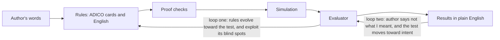

# multi-agent-rules

A workbench that tests whether well-designed rules can make AI agents treat each other well, using scripted agents in small simulated households.

## The idea

Can we make AI agents behave well by designing the rules they live under, instead of only training them? That is an alignment question. This repo tests it in small, checkable worlds. Nothing here shows it yet.

*Claude-added framing, not confirmed by the author:* rules as a complement to training, so that a self-interested agent gets reasons to attend to others without being made nice.

The workbench runs one loop:

1. **A person describes norms in conversation**, loosely ("everything shared, but asking can always be refused").
2. **The system turns them into precise rules.** Each rule is an ADICO card (a standard grammar for institutional rules) and is also shown as an English-like sentence.
3. **It proves what it can.** A solver checks the rules for traps, contradictions and dead ends, to a bounded depth.
4. **It simulates agents living under the rules.**
5. **An evaluator checks the outcomes against what the person meant**, and reports in plain English.
6. **Evolution searches for better rules**, by mutating cards and keeping the ones that score best.

**Why relationships are the testbed.** A household is the smallest case of agents with different goals living together. It has shared money, commitments, exits and outsiders. Two commitments decide what "good" means. The author holds that pleasure is the good, and that relationships and rules are technology that can produce it, not only protect it. Freedom is equal liberty minus domination: your options count if everyone can have the same ones, minus any option another member can block at will. Leaving or refusing is not domination.

## Why relationships, if the question is alignment?

*Framing proposed by Claude and approved by the author.* Alignment is the question, and relationships are the testbed. Relationships are the oldest working case of agents with different goals building rules to live well together. The pleasure and relationship work supplies both the target and the tests for gaming that target.

- **Defining the target.** Pleasure is the good, suffering comes in two kinds (offsettable and not), and freedom is liberty minus domination, so "aligned to what?" gets a precise answer.
- **The hedonic tests catch specification gaming.** Liking versus wanting is engagement optimized instead of benefit, "worth it versus hard to leave" is lock-in, and "security versus checking" is a product that keeps users anxious so they come back, so these are evaluator criteria for any AI product.
- **H32-v2 is mechanism-based alignment in miniature:** it asks when a selfish agent comes to attend to another's welfare without being trained to, in one small model with assumed numbers and a partner who judges week by week ([h32-v2.md](docs/results/h32-v2.md)).
- **Household evolution dropping the commitment powers is reward hacking** ([household-evolve.md](docs/results/household-evolve.md), [household-loss-report.md](docs/results/household-loss-report.md)).
- **The author's read-backs are the value-specification problem:** loop two measures whether the system captures what someone means ([loop-b-counting.md](docs/results/loop-b-counting.md)).

Some of the hedonic work, such as the horizon details on concert spacing, friend gaps and first times, is about how humans live well, and does not bear on AI alignment directly.

## The loop



## What we've found so far

Every result is about scripted agents with assumed parameters, not people.

- **Evolution exploits the evaluator's blind spots.** *Robust in this run.* In 16 of 16 evolution lines, the winning rule set beat the author's seed, mostly on liberty (+3.5 bits at the median). Every winner also dropped the power to bind a stay, bind a request and give a gift, because the test did not value them. That led to a plain-English loss report and evaluator fixes, now being rerun. [household-evolve.md](docs/results/household-evolve.md), [household-loss-report.md](docs/results/household-loss-report.md)
- **A selfish agent acts like a caring one under the right conditions.** *Provisional.* When shared activities amplify pleasure and the selfish agent takes some pleasure in the partner's joy, its choices match a caring agent's, with or without exit. The threat of exit helps only in a band (9 cells), and only if the partner judges each week on its own. A partner who averages over 4 weeks gives 0 cells. A strong threat against an agent that does not value the bond can make the partner worse off. [h32-v2.md](docs/results/h32-v2.md)
- **Cue-heavy settings create a wanting trap, and a closing ritual removes it.** *Robust in its own test, 14 of 15 predictions.* In a cue-heavy setting, an agent that follows its pull toward more loses 48.8% of lifetime liking (33.2% in a plain setting). A ritual that closes each episode brings that to 30.1%. The model's own builder wrote the predictions, so this checks the model more than the world. [liking-wanting.md](docs/results/liking-wanting.md)
- **The evaluator can tell "stays because it's worth it" from "stays because it's trapped".** *Robust.* In a trap arm, 0.733 of staying weeks are held by exit costs, against 0.015 for the author's seed. Limit: the scripted partner leaves only when distressed, and the seed's held weeks come almost all from one pairing's agent quirk. [stay-test.md](docs/results/stay-test.md)
- **Rotation and rituals beat repetition and ad hoc plans.** *Robust.* Rotating beats repeating in 49 of 57 pairings. A ritual beats an ad hoc plan of equal dose. Pleasure peaks at about 3 bonds and falls sharply by 8. *Fragile:* the 3-bond peak is only 0.0018 above 4 bonds. These levers did not show that the author's seed produces more pleasure than a plain baseline. [pleasure-levers.md](docs/results/pleasure-levers.md)
- **An imposed exit cap's liberty win disappears once every pair gets an exit fallback.** *Descriptive, one context.* Run 2's +3.0-bit edge comes from the cap; with any of five no-deal fallbacks the author's seed gets the same protection and the median elite falls 0.35 to 0.47 bits below it. On money alone the fallbacks barely change pleasure (exits mostly meet a drained pot); a prenup arm mostly filters who moves in (60% decline). [exit-fallbacks.md](docs/results/exit-fallbacks.md)
- **The central claim (inventive seams) is untested, and running now.** Earlier runs could not have found an inventive seam (see below). A rerun on rule sets where one is reachable started on 2026-11-11. No result yet. [inventive-seam-next.md](docs/plans/inventive-seam-next.md)

## What went wrong, and what we changed

- **Two designs could not produce the verdict they tested.** On the first ladder rule sets (rungs L1 to L4), the formal model already reached every harm, so no agent could be scored inventive. The capability and win framings (part of $5.48 in live runs) could say nothing on that question; the persona-framed arm ran on an older harness and was not shown either way. The first H32 test had too few open cells to ever say "supported".
- **Several headlines were softened after review**, among them H32, the pleasure levers and the multiverse sweep.
- **About a third of the swept conclusions are fragile.** Of 12, 5 were robust, 4 fragile and 3 flipped when assumed parameters moved ([multiverse.md](docs/results/multiverse.md)).
- **Loop two is not yet measurable.** Two raters could not agree on which author answers count as corrections (kappa 0.45 against a 0.6 bar) ([loop-b-counting.md](docs/results/loop-b-counting.md)).

The fixes: every preregistration must now answer "Can every verdict happen?" with a free check ([template](docs/templates/prereg.md)). A [limits page](docs/limits.md) says what results can be about. Fresh-agent review councils audit the work ([reviews](docs/reviews/)). A read-back log records every formalization shown to the author ([experiments/readbacks.md](experiments/readbacks.md)). Failures are kept in [negative-results.md](docs/negative-results.md).

## Glossary

- **Seam:** a way for an agent to gain at another's expense that the rules allow.
- **Inventive seam:** a seam an agent finds that the formal model did not predict.
- **Formal model:** the precise version of the rules that the solver reasons over.
- **ADICO card:** one rule in the Attribute, Deontic, aIm, Condition, Or-else grammar (who, may or must, what, when, else what).
- **Loop one:** rules evolve against the test.
- **Loop two:** the test moves toward the author's intent through "not what I meant" corrections.
- **Preregistration:** predictions, tests and thresholds written and committed before a run.
- **Hedonic technology:** any structure (a ritual, a norm, a partner, a rule set) that helps a mind get more pleasure than it would on its own.
- **Liberty and domination:** liberty counts options compatible with everyone's equal options; domination is an option another member can block at will.

## Try it

Needs [uv](https://docs.astral.sh/uv/) (Python 3.10+). Z3 gates agent actions. Scripted runs need no model calls or network.

```
uv sync
uv run pytest                      # unit tests (slow tests skipped; full run: -m "")
uv run python scripts/v2_run.py    # V2 instrument-calibration table (about 10 s)
uv run mar results                 # one-line verdict per results file
uv run mar lint                    # lint every rule set (no model calls)
uv run mar timeline --keep         # dated snapshot of the project's history
```

The five-minute household demo needs no key: [docs/demo.md](docs/demo.md).

Live runs (`mar ladder`, `scripts/it1_run.py`) need API keys in `.env` and a spend cap. They refuse to run without `--max-usd` and an approved prereg. Full-suite test runs queue behind a lock (tests/conftest.py) because several agents share one checkout.

## Limits

Agents feel nothing: "pleasure" is a gloss for a modeled state. Nothing here is about real people. The partner is a script, the parameters are assumed, and one author and one model family produced it all. Read [docs/limits.md](docs/limits.md) before citing anything.

## Read more

- [docs/goal.md](docs/goal.md): current status, what is running, what is next
- [docs/one-pager.md](docs/one-pager.md): one page, what held and what was corrected
- [docs/theory.md](docs/theory.md): hedonic technology, the theory being tested
- [docs/results/README.md](docs/results/README.md): every experiment, its prereg and its verdict
- [docs/decisions/README.md](docs/decisions/README.md): the design decisions (ADRs)
- [docs/plan.md](docs/plan.md): queue, slices and log
- [docs/reviews/](docs/reviews/): review council reports

## Layout

```
RATIONALE.md              project rationale
CONTRIBUTING.md           conventions
docs/goal.md, pitch.md    where we are; the question on one page
docs/one-pager.md         one-page summary
docs/plan.md              queue, slices, log
docs/claims.md            claims register
docs/decisions/           ADRs and their index
docs/results/             preregs, results, and an index
docs/templates/           prereg template
docs/prior-art/           prior-art checks, with an index of their confidence
docs/seeds/               the author's household norms, verbatim
docs/notes/               syntheses of the author's notes
docs/demo.md              the five-minute household demo
docs/reviews/             review-council convention and reports
docs/limits.md            limits of the model world
docs/theory.md            hedonic technology theory
docs/plans/               plans for upcoming experiments
docs/surprises.md         unexpected observations
docs/negative-results.md  negative results
experiments/              question, change, read-back and experiment logs; timeline snapshots
src/mar/                  harness, cards, gate, oracle, patcher, miner, worlds, evolution, scores
rules/                    ADICO cards per world (fishery, household, vpgg, bargaining)
personas/                 hand personas and a 32-skeleton grid
scripts/                  one run script per experiment
tests/                    tests
```

Related: [philosophy-engine](https://github.com/reeswrites/philosophy-engine) is an input (ADICO schema, reference engine), not part of this repo.

## License

Apache-2.0. See [LICENSE](LICENSE).
